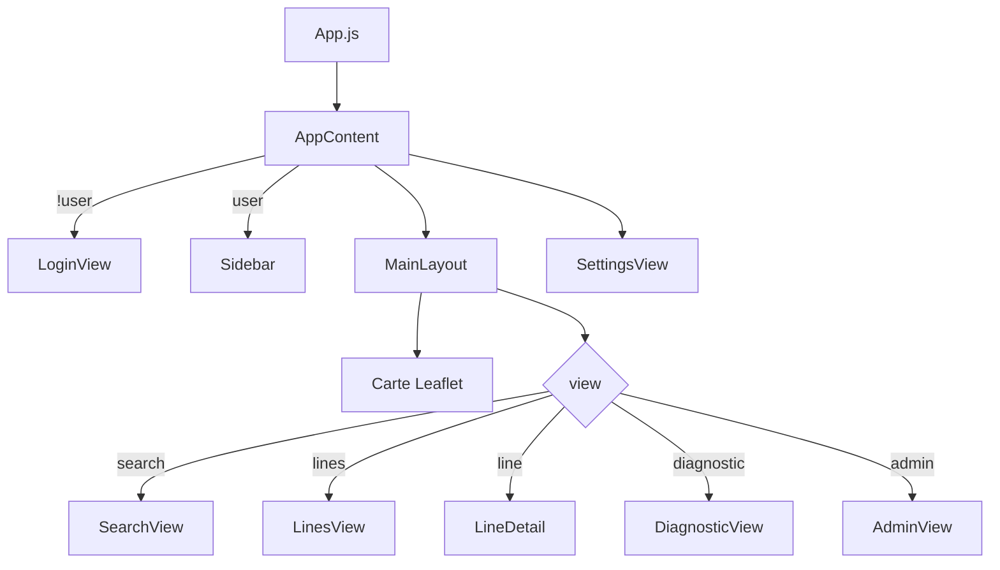

# Taxi be Ako — Documentation du projet

Application web de transport urbain à **Antananarivo** : recherche d'itinéraires en bus, carte interactive (Leaflet), gestion des lignes et des arrêts.

---

## Architecture générale

```
taxi_be_ako/
├── config/              # Django (settings, urls racine)
├── transport/           # API transport (lignes, arrêts, trajets, graphe)
├── comptes/             # Authentification et historique utilisateur
├── coeur/               # Pages racine Django
└── taxi_be_ako_frontend/  # React (Create React App)
    └── src/
        ├── App.js                 # Point d'entrée React
        ├── app/                   # Logique applicative centrale
        ├── components/            # Vues + carte Leaflet
        ├── utils/                 # API, lignes, positions, géocodage OSM
        ├── data/fallback.js       # Données hors-ligne
        └── hooks/                 # Hooks React (tracé routier OSRM)
```

### Stack

| Couche | Technologie |
|--------|-------------|
| Frontend | React 18, Leaflet / react-leaflet |
| Backend | Django REST (JSON) |
| Carte | Tuiles OpenStreetMap |
| Géocodage arrêts | bus_stop OSM (Overpass) |
| Calcul trajet | A* (`AlgorithmeSearchOptimized`) |
| Tracé carte (sans GPS en base) | OSRM (router.project-osrm.org) |

### Démarrage

```bash
# Backend
python manage.py runserver 127.0.0.1:8000

# Frontend (proxy vers Django)
cd taxi_be_ako_frontend && npm start
```

---

## Fichiers de code importants

### Frontend — cœur applicatif

| Fichier | Rôle |
|---------|------|
| `src/app/useAppLogic.js` | **État global** : auth, données, recherche trajet, carte, mode hors-ligne |
| `src/app/AppContent.js` | Assemble Sidebar + MainLayout + vues selon `view` |
| `src/app/Sidebar.js` | Navigation latérale |
| `src/components/MainLayout.js` | Carte Leaflet + panneau droit + calibration arrêt |
| `src/components/MapLayers.js` | Polylines (lignes, trajets, marche) |
| `src/utils/lines.js` | Lignes, segments trajet, alternatives, couleurs |
| `src/utils/positions.js` | Coordonnées arrêts et tracés GPS |
| `src/utils/stopGeocoding.js` | Alignement arrêts sur marqueurs OSM |
| `src/utils/api.js` | Client HTTP + routage OSRM |
| `src/data/fallback.js` | Données demo si backend indisponible |

### Backend — transport

| Fichier | Rôle |
|---------|------|
| `transport/views.py` | Endpoints API (`sync`, `trajet`, CRUD admin…) |
| `transport/serializers.py` | JSON lignes / arrêts / trajets |
| `transport/services/optimized.py` | Algorithme A* (trajet optimal) |
| `transport/services/baseline.py` | Graphe + BFS (référence) |
| `transport/services/stop_geocoding.py` | Alignement coordonnées sur OSM |
| `transport/models.py` | Modèles `Arret`, `Ligne`, `LigneArret`, `Correspondance` |

### API principales

| Méthode | URL | Usage |
|---------|-----|-------|
| GET | `/api/sync/` | Lignes + arrêts + correspondances |
| GET | `/api/osm-bus-stops/` | Index arrêts bus OSM |
| POST | `/api/trajet/` | Calcul itinéraire `{ depart, arrivee }` |
| POST | `/api/login/` | Connexion |
| GET | `/api/me/` | Utilisateur courant |
| PATCH | `/api/arrets/<id>/` | Modifier un arrêt (admin) |

---

## Navigation de l'application (`view`)

État géré dans `useAppLogic.js` → `view` :

| Valeur | Écran affiché |
|--------|---------------|
| `search` | Recherche d'itinéraire (défaut) |
| `lines` | Liste de toutes les lignes |
| `line` | Détail d'une ligne |
| `diagnostic` | État connexion backend |
| `admin` | Administration (rôle admin uniquement) |

---

## Carte des boutons (frontend)

Pour chaque bouton : **fichier → handler → fonction → effet**.

---

### 1. Connexion (`LoginView.js`)

| Bouton | Handler | Chemin du code | Effet |
|--------|---------|----------------|-------|
| **Se connecter** / **Créer mon compte** | `handleSubmit` | `LoginView.js` → `POST /api/login/` ou `POST /api/utilisateurs/` puis login | `onLogin(user)` → `useAppLogic.handleLogin` → `setUser` → affiche l'app |
| **Pas encore de compte ? / Déjà un compte ?** | `toggleMode` | `LoginView.js` | Bascule `mode` login ↔ register |

---

### 2. Barre latérale (`Sidebar.js`)

| Bouton | Handler | Chemin du code | Effet |
|--------|---------|----------------|-------|
| **Taxi be Ako** (logo) | `showSearch` | `Sidebar` → `useAppLogic.showSearch` | `view = 'search'`, efface ligne surbrillée |
| **Recherche** | `showSearch` | idem | `view = 'search'` |
| **Lignes** | `setView('lines')` | `Sidebar` → `useAppLogic.setView` | `view = 'lines'` |
| **Diagnostic** | `setView('diagnostic')` | idem | `view = 'diagnostic'` |
| **Admin** | `setView('admin')` | idem (si `showAdmin`) | `view = 'admin'` |
| **Paramètres** (icône engrenage) | `setShowSettings(true)` | `Sidebar` → `AppContent` | Ouvre modal `SettingsView` |
| **Déconnexion** | `handleLogout` | `useAppLogic.handleLogout` → `POST /api/logout/` | Reset état, retour login |

---

### 3. Carte connexion backend (`ConnectionCard.js`)

| Bouton | Handler | Chemin du code | Effet |
|--------|---------|----------------|-------|
| **Détails / Cacher** | `setShowDetails` | local `ConnectionCard` | Affiche/masque le détail connexion |
| **Vérifier** | `onRefresh` | `ConnectionCard` → `useAppLogic.refreshData` | `GET /api/sync/` + `GET /api/osm-bus-stops/` → met à jour lignes/arrêts |

---

### 4. En-tête carte (`MainLayout.js`)

| Bouton | Handler | Chemin du code | Effet |
|--------|---------|----------------|-------|
| **Rafraîchir** | `onMapMove` | `MainLayout` → `refreshData` | Recharge données backend |

---

### 5. Recherche d'itinéraire (`SearchView.js`)

| Bouton | Handler | Chemin du code | Effet |
|--------|---------|----------------|-------|
| **Trouver** (submit formulaire) | `onSearch` | `SearchView` → `useAppLogic.handleSearch` | `POST /api/trajet/` ; si offline → `buildLocalTrajet` / alternatives ; affiche tracé sur carte |
| **LineCard** (clic carte) | `onHighlightLine` | `SearchView` → `useAppLogic.highlightLineOnMap` → `findFullLine` → `setHighlightedLine` | Trace la ligne complète sur la carte |
| **Détails** (LineCard) | `onOpenLine` | `SearchView` → `useAppLogic.openLine` | `view = 'line'`, ligne sélectionnée |
| **Arrêt correspondant** (passage) | inline | `setPassageQuery` + `onHighlightLine` | Filtre passage + surbrillance ligne |
| **Voir sur la carte** (alternative) | `onSelectAlternative` | `useAppLogic.showAlternativeOnMap` → `buildTrajetFromAlternative` | Affiche trajet alternatif sur carte |
| **Chip ligne départ/arrivée** | `onHighlightLine` | idem highlight | Surbrillance ligne |
| **Boutons ligne** (alternatives détaillées) | `onHighlightLine` | idem | Surbrillance ligne départ ou arrivée |

---

### 6. Résultat trajet (`RouteResult.js`)

| Bouton | Handler | Chemin du code | Effet |
|--------|---------|----------------|-------|
| **Ligne X — Voir sur la carte** (trajet direct) | `onHighlightLine(departLine)` | `RouteResult` → `highlightLineOnMap` | Ligne surbrillée sur carte |
| **Départ en ligne / Arrivée en ligne** | `onHighlightLine` | idem | Surbrillance ligne concernée |
| **Bouton compact par segment** | `onHighlightLine(step.line)` | idem | Surbrillance ligne du segment |

---

### 7. Liste des lignes (`LinesView.js`)

| Bouton | Handler | Chemin du code | Effet |
|--------|---------|----------------|-------|
| **LineCard** (clic) | `onHighlightLine` | `LinesView` → `highlightLineOnMap` | Trace ligne sur carte |
| **Détails** | `onOpenLine` | `LinesView` → `openLine` | `view = 'line'` |

---

### 8. Détail ligne (`LineDetail.js`)

| Bouton | Handler | Chemin du code | Effet |
|--------|---------|----------------|-------|
| **Retour aux lignes** | `onBack` | `LineDetail` → `AppContent` `setView('lines')` | Retour liste lignes |

---

### 9. Diagnostic (`DiagnosticView.js`)

| Bouton | Handler | Chemin du code | Effet |
|--------|---------|----------------|-------|
| **Relancer le diagnostic** | `onRefresh` | `DiagnosticView` → `refreshData` | Recharge `/api/sync/` |

---

### 10. Paramètres (`SettingsView.js`)

| Bouton | Handler | Chemin du code | Effet |
|--------|---------|----------------|-------|
| **Fermer (×)** / clic overlay | `onClose` | `AppContent` → `setShowSettings(false)` | Ferme modal |
| **Modifier profil** | `setIsEditingProfile(true)` | local | Mode édition profil |
| **Enregistrer profil** | `handleSaveProfile` | `SettingsView` → `PATCH /api/utilisateurs/<id>/` | Met à jour profil |
| **Annuler édition profil** | reset form | local | Annule modifications |
| **Langue** (FR / MG / EN) | `onLanguageChange` | `LanguageContext` | Change traductions |
| **Thème** (clair / sombre) | `onThemeChange` | `useAppLogic` → `localStorage` | Change thème CSS |
| **Historique trajets** | `setShowTripHistory` | toggle local | Affiche historique |
| **Supprimer trajet** | `handleDeleteTrip` | `DELETE /api/users/trips/<id>/` | Supprime entrée historique |

---

### 11. Administration (`AdminView.js`) — admin seulement

| Bouton | Handler | Chemin du code | Effet |
|--------|---------|----------------|-------|
| **Onglets** (Lignes / Arrêts / Associations) | `setTab` | local | Change panneau admin |
| **Nouvelle ligne** | `startNewLine` | local | Formulaire ligne vide |
| **Enregistrer ligne** | `saveLine` | `POST/PUT /api/lignes/` | Crée/modifie ligne |
| **Annuler ligne** | `cancelEditLine` | local | Reset formulaire |
| **Modifier / Supprimer ligne** | `startEditLine` / `deleteLine` | `GET/DELETE /api/lignes/<id>/` | Édition / suppression |
| **Nouvel arrêt** | `startNewArret` | local | Formulaire arrêt vide |
| **Enregistrer arrêt** | `saveArret` | `POST/PATCH /api/arrets/<id>/` | Crée/modifie arrêt |
| **Modifier / Supprimer arrêt** | `startEditArret` / `deleteArret` | CRUD arrêts | Édition / suppression |
| **Ajouter arrêt à la ligne** | `addStopToLine` | `POST /api/ligne-arrets/` | Association ligne↔arrêt |
| **Retirer arrêt de la ligne** | `removeStopFromLine` | `DELETE /api/ligne-arrets/<id>/` | Supprime association |

---

### 12. Calibration arrêt sur carte (`MainLayout.js`)

Mode activé quand `calibratingArretId` est défini (depuis admin).

| Action | Handler | Chemin du code | Effet |
|--------|---------|----------------|-------|
| **Clic sur la carte** | `pickCalibratedCoords` | `MapClickHandler` → `useAppLogic.pickCalibratedCoords` | Met à jour lat/lng choisis |
| **Enregistrer (✓)** | `saveCalibratedArret` | `useAppLogic.saveCalibratedArret` → `PATCH /api/arrets/<id>/` | Sauvegarde position OSM |
| **Annuler (✕)** | `setCalibratingArret(null)` | `MainLayout` | Quitte mode calibration |

---

## Flux principaux

### Chargement des données

```
AppContent (user connecté)
  → useAppLogic.refreshData()
    → GET /api/sync/
    → GET /api/osm-bus-stops/
    → alignArretsList()   (stopGeocoding.js)
    → setData({ lignes, arrets, correspondances })
```

### Recherche d'itinéraire

```
SearchView [Trouver]
  → handleSearch()
    → POST /api/trajet/ { depart, arrivee }
    → setTrajet(result)
    → si 1 ligne : highlightLineOnMap(findFullLine(...))
    → MainLayout affiche TripRouteLayers OU LineRouteLayer
```

### Affichage tracé sur carte

```
MapLayers.js
  → getLineRouteData / getSegmentRouteData (positions.js)
  → useRoadRoutePositions (OSRM si pas de trace GPS)
  → Polyline Leaflet
```

### Calcul trajet backend

```
POST /api/trajet/
  → AlgorithmeSearchOptimized.calculer_trajet()
    → construire_graphe() (+ arêtes marche)
    → dijkstra() [A*]
    → _etapes() → trajet_to_dict()
```

---

## Schéma des vues React



---

## Commandes Django utiles

```bash
python manage.py charger_donnees_demo    # Données de démo
python manage.py aligner_arrets_osm      # Aligner arrêts sur OSM en base
python manage.py creer_admin             # Compte admin
```

---

## Identifiants demo

- Utilisateur : `admin`
- Mot de passe : `admin123`
